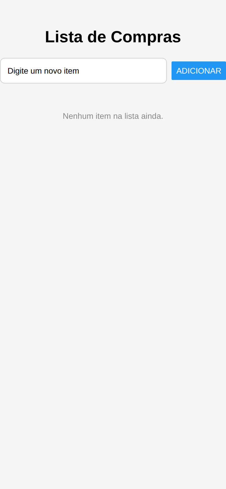
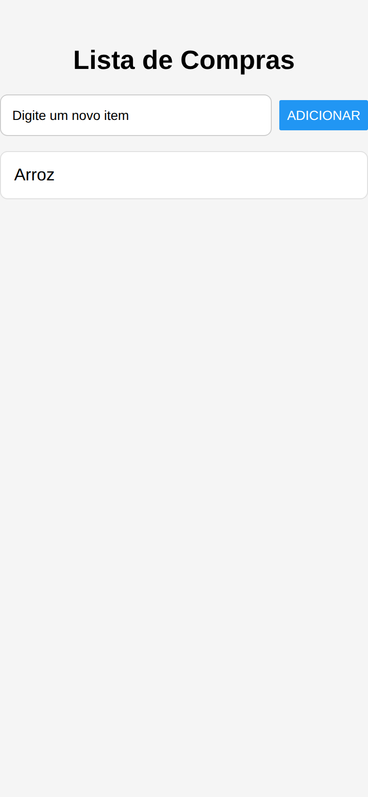
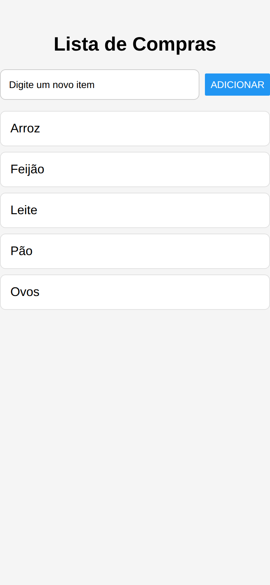

# Lista de Compras

CheckPoint 2 — Cross-Platform Application Development.

App React Native (Expo) de lista de compras simples, construído em torno de `FlatList` + `useState`.

## O que o app faz

- Título do app;
- `TextInput` para digitar um novo item;
- Botão **Adicionar**, que insere o item na lista com `useState` (criando um array novo via spread, sem `.push()`);
- Lista exibida com `FlatList`.

Todo o código está em `App.js`.

## Como rodar

```bash
npm install
npx expo start
```

Depois, escaneie o QR code com o app Expo Go no celular, ou pressione `w` para abrir no navegador.

## Prints

| Lista vazia | 1 item | 5 itens |
|---|---|---|
|  |  |  |
